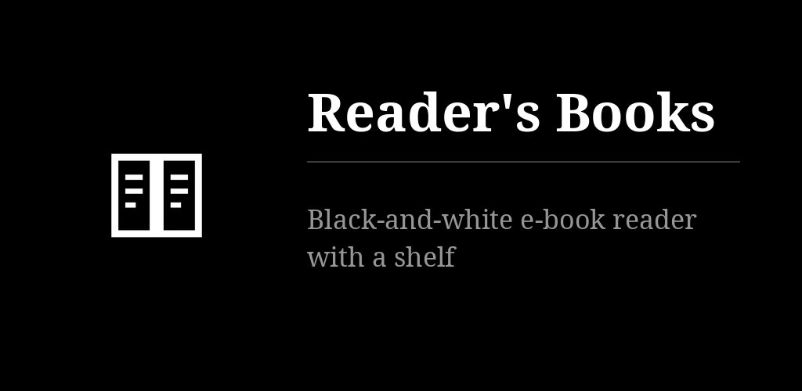
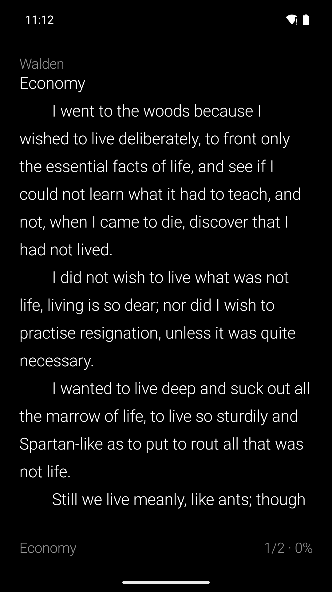
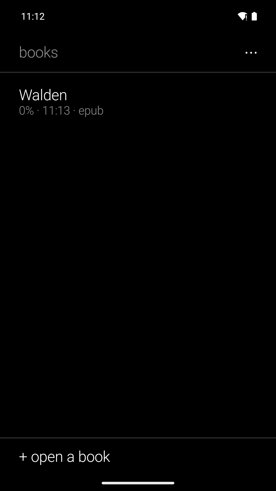

# Reader's Books

A shelf as a plain list; books as pages of text cut at whole lines, turned by a tap — made
for e-ink. EPUB, MOBI, FB2, TXT; the place in each book is kept. No store, no account; the
network is used only if you set up a library on your own drive. It extends the built-in reader of
[Reader's Launcher](https://github.com/funkypitt/readers-launcher) into a shelf.

## Key points

* The shelf lists title, how far you are, when you last opened it. Tap to read. With a library
  set up, the app opens on the library instead: at its top, the book read last (one tap and it
  is at its page), then "on this phone", the shelf. Without one, a quiet line under the shelf
  leads to setting one up.
* A tap on the right third of the screen turns forward, on the left third back, in the middle
  it opens the menu: chapters, larger or smaller text, book text in sans-serif or serif
  (Literata), back to the shelf, remove.
* The faces travel with the app: Roboto Light, Literata and Roboto Mono are in the APK, so the
  text looks the same on every device, whatever font the device has set.
* Highlights and comments, in every book: press and hold a word, slide over the
  passage, then "highlight" or "comment". A highlight is a grey band behind the words, with a
  line under it when it carries a comment; a tap on it shows the comment, changes it or removes
  the highlight. In a book of the library they are kept in a file next to the book on the drive
  (`<book file>.highlights.json`), so every device that opens the book has them: each device
  folds its own into that file, highlight by highlight, the one changed last winning. A book
  opened from the phone keeps them on the phone, in a file of the same form; when the same book
  comes from the library later (the same file, or an EPUB with the same identifier and title),
  or is added to it, they are folded into the library's. The
  book's menu exports them as text. Given the WebDAV address of the Reader's Notes folder, the
  app also keeps a note per book there (folder `Reader's Books`): the passages between
  quotation marks, in the order of the book, each followed by its comment —
  [Reader's Notes](https://github.com/funkypitt/readers-notes) shows it read-only.
* The same file carries the place the book was left at: a book of the library opens where it was
  last read, on whichever device, and the shelf says how far it is.
* Add a book from the shelf, from a file manager ("open with"), or by sharing the file to the
  app. Books are copied into the app, so the original can move.
* A book opened that way can join the library: "add to the library" in its menu copies it to
  the drive, into the folder you choose (nothing there is written over), and from then on its
  highlights and the page you are at travel like those of any book of the library.
* The position is kept per book and survives a change of text size or screen. The screen
  stays on while a page is open, until fifteen minutes after the last turn.
* Pictures in EPUBs are shown in the page, scaled to the text width and never cut; a tap in
  the middle of a picture shows it on the whole screen, to zoom with two fingers (a double tap
  zooms in or back; a tap or back closes it) — the way to read a table. Styles and footnote
  links are dropped; footnotes are small print. MOBI means PalmDoc; no PDF (a paper in PDF
  becomes an EPUB in the desktop app, and comes here through the library).
* **news** in the library (there only when the library holds some): the issues of newspapers and
  magazines from every folder in one list, the newest first by the file's creation date on the
  drive (else its last change). An issue is told from a book as the reader tells a magazine —
  its contents page names a section and a title per article, or its articles begin with a
  section and a headline — read on the drive without downloading the book: the end of the EPUB
  (its zip directory), then its package and its nav, a few kilobytes each, three at a time, the
  latest files first; what is found is remembered for each file (`library-kinds.json`) until the
  file changes. Books already on the phone are told by what the reader found.
* A magazine issue (an EPUB whose contents page carries a section, a title and an author per
  article, as the newspapers pipeline writes them) opens on its contents the first time:
  sections, titles, authors and larger pictures in a list that scrolls, opened on the article
  read last; a tap opens an article. An article is a chapter; a slim bar on
  top leads to the previous article, the contents and the next one, and each article reopens
  where it was left. Opened again, an issue goes back to the article it was left at. Several
  issues of one magazine make one line of the shelf (« 24 heures · 3 issues »): a tap opens the
  latest, a long press lists them all. Issues belong to the same magazine when their titles
  agree once the date is taken off.
* Italic and bold show in every book; the text itself, where highlights are counted, is the same
  as without them.
* Books and magazines are set the way their publisher set them, from the book's own style
  sheets: headings in their sizes, centred, right-aligned and justified text, indents and the
  space between paragraphs, quotations and verse in their margins, lists with bullets and
  numbers, tables as grids, small capitals, raised notes, rules, pictures at their own size with
  their captions, large initials, a new page where the book asks for one, the lines of code and
  verse. The font, size, margins and colours stay the reader's; text written over several lines
  of the source reads as one paragraph. Nothing of this changes the text, where highlights are
  counted.
* A folder of the library can be followed (long press on it): it then sits near the top of the
  library with the number of its new books, counted from the last listing of the drive. Nothing
  is downloaded by itself: a tap lists that folder again, fetches its new books one after the
  other and opens the new one, or the folder's issues when several came or none.
* Optional library: the e-books kept on a drive, at a WebDAV address with a username and an
  application password (kDrive, Nextcloud, any WebDAV server) that the app may read and write,
  listed by folder — every folder, or the top folders only, each standing for everything inside
  it (the library's menu) — or all in one list; a folder can show the books of its subfolders
  too. Every list has its order: folders by name, latest book or number of books; books by date,
  name, author or last opened (the author is what precedes " - " in the file name, else the
  folder's name); the shelf by last opened, title or last added.
  Nothing is downloaded until you tap a book; a book held long in a list is downloaded to be
  kept on the phone, to read without a connection — several in a row before a trip. The shelf
  is what is on the phone: it says how many books, how much room they take, how many are kept;
  it can be ordered by size. A book's menu keeps it on the phone or lets it go, and removes
  its copy (the book stays on the drive). In the settings, the books of the library not opened
  for a month, three or six leave the shelf by themselves — once the drive is known to hold
  their highlights and their place — unless kept; nothing leaves unless you ask. A book whose
  copy on the drive is newer says so, and its menu downloads it again, the page you are at kept.
  Without a connection, the library shows its last list and says so; what is on the shelf reads
  as ever. The library syncs with the "sync now" row near its top; what is known stays on
  the screen while the drive is walked, new books appear, books gone from the drive go. Asked
  for by hand, a sync keeps going while the phone is locked (a quiet notification counts
  folders and books); cut short, "continue the scan" carries it on where it stopped. Once the drive has
  been walked, the library offers to keep only some of its folders (with everything inside
  them): fewer folders, faster syncs — the choice is in the library's menu and in the settings.
  A folder held long is left out instead, with everything inside it, whatever else is chosen:
  neither shown nor synced, until it is taken back in from the same list.
  The account can be exported and imported as the Reader's credentials file shared by the
  other Reader's apps (`readers-books-credentials.json`, saved where you choose, then offered
  to the share menu).
* The transcripts made in [Reader's Podcasts](https://github.com/funkypitt/readers-podcasts)
  arrive by themselves: it sends each one, as a small book, to a `transcriptions` folder at the
  top of the library (a folder per channel), and that folder is looked at again every time the
  library is opened, whatever folders are chosen — no sync to ask for. They are books like the
  others: read, highlighted, commented, with their note in Reader's Notes.
* One home-screen widget for any launcher: the book being read and the position; tap carries
  on at the current page. The launcher's book tile shows the same.

## Install

- **F-Droid** (recommended, updates arrive by themselves): add the repository from [gallaz.ch/eink](https://gallaz.ch/eink/#fdroid), or the address `https://funkypitt.github.io/fdroid-repo/repo` in F-Droid.
- **Obtainium**: tap the badge on the phone, or add `https://github.com/funkypitt/readers-books` in Obtainium.
- **APK**: attached to the [latest release](../../releases/latest). No automatic updates.

All three deliver the same file, with the same signature.

## Build

`./gradlew assembleDebug` (JDK 17+, Android SDK 35).

## Crédits / Credits

© 2026 Pierre Gallaz. Développé avec [Claude Code](https://claude.com/claude-code) (Anthropic).
Licence MIT, voir `LICENSE`.

© 2026 Pierre Gallaz. Developed with [Claude Code](https://claude.com/claude-code) (Anthropic).
MIT licence, see `LICENSE`.

## Captures d'écran

 
